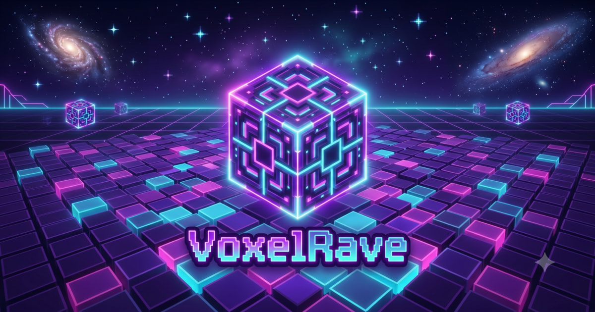

# ⚡ VoxelRave

<div align="center">



**A real-time multiplayer 3D voxel rhythm-survival party game built with Next.js 16, React Three Fiber, Fastify, and Socket.io.**

[](https://voxelrave.com)
[](LICENSE)

<br/>


-000000?style=flat-square&logo=next.js&logoColor=white)


</div>

---

## 📖 Table of Contents

- [🎮 Gameplay Overview](#-gameplay-overview)
- [✨ Key Technical Highlights](#-key-technical-highlights)
- [🏛️ System Architecture & Netcode](#️-system-architecture--netcode)
- [⚡ Performance & WebGL Optimizations](#-performance--webgl-optimizations)
- [🛡️ Security & Anti-Cheat Engine](#️-security--anti-cheat-engine)
- [🧰 Tech Stack](#-tech-stack)
- [📁 Project Structure](#-project-structure)
- [🚀 Getting Started](#-getting-started)
- [🔐 Environment Variables](#-environment-variables)
- [🧪 Testing & Quality Assurance](#-testing--quality-assurance)
- [📄 License & Intellectual Property](#-license--intellectual-property)

---

## 🎮 Gameplay Overview

**VoxelRave** is an energetic, high-intensity rhythm party game where players dance on an evolving 12×12 voxel disco floor. The objective is simple: survive each round by standing on the announced winning color before the dance floor collapses beneath your feet.

1. **Enter the Arena**: Join public matchmaking or spin up a private room with a 4-letter shareable code.
2. **Warm Up in the Lobby**: Customize your 3D voxel dancer, toggle match modifiers, chat with opponents, and ready up.
3. **The Dance Phase**: Navigate the 144-block arena using keyboard arrows, WASD, or mobile touch controls.
4. **Color Announcement & Disappearance**: The server randomly picks the target color. Under modifiers like **Blackout / Blind Mode**, arena colors vanish, requiring sharp photographic memory.
5. **Voxel Elimination**: Non-matching tiles fall into the neon void. Any player caught standing on eliminated blocks falls and loses a life.
6. **Spectator Mode**: Eliminated players transition to a 3D orbital spectator camera with dedicated dead-chat to watch the drama unfold.
7. **Victory Celebration**: The last dancer standing enjoys a victory screen with quantized voxel fireworks and dynamic celebratory cameras.

---

## ✨ Key Technical Highlights

* **Authoritative Server Architecture**: Fastify + Socket.io server controls the game clock, validates all movement, and broadcasts synchronized state updates at a steady 20 Hz tick-rate.
* **Client-Side Prediction & Reconciliation**: Zero-latency movement on the client with instant rollback/snap-back if an invalid position is detected by the server.
* **Custom 3D Avatar Locker**: Real-time interactive avatar visualizer powered by React Three Fiber and OrbitControls. Allows custom suits, animated headphones, jetpacks, cyber pets, and color-conflict locking.
* **Singleplayer Practice & Global Leaderboard**: Full offline-capable singleplayer mode backed by a tamper-resistant Supabase leaderboard with server-side telemetry anti-cheat verification.
* **Custom Match Modifiers**:
  * **Colors**: 4 (Easy), 6 (Normal), 8 (Hard), or 10 colors (Extreme).
  * **Game Speed**: Chill, Standard, or Turbo progressive tempo.
  * **Lives**: 1 (Sudden Death), 3, or 5 lives.
  * **Board Shrinking**: Gradual arena collapse in later rounds (Chaos mode shrinks from Round 1).
  * **Player Collisions**: Host-controlled physical pushing and blocking.
* **Responsive Multi-Platform Support**: Dynamic camera FOV adjustment for desktop, mobile portrait, and landscape orientations with an on-screen virtual D-Pad.
* **Bilingual Localization (EN / ES)**: Seamless runtime language switching with automatic HTML `lang` synchronization and localized error notifications.

---

## 🏛️ System Architecture & Netcode

```
┌────────────────────────────────┐                 ┌─────────────────────────────────┐
│     CLIENT (React 19 + R3F)    │                 │   SERVER (Fastify + Socket.io)  │
│                                │                 │                                 │
│  [Player Input WASD / Touch]   │                 │                                 │
│               │                │                 │                                 │
│  [Client-Side Prediction]      │                 │                                 │
│  Instant local movement (0ms)  │                 │                                 │
│               │                │                 │                                 │
│               ▼                │  player:move    │                                 │
│       Socket Emit (HMAC)       ├────────────────►│  1. Verify HMAC Session Token   │
│                                │                 │  2. Validate Rate Limit (<80ms) │
│                                │                 │  3. Validate Phase (DANCING)    │
│                                │                 │  4. Bounds Check (0 - 11 grid)  │
│                                │                 │  5. Collision & Push Physics    │
│                                │                 │  6. Apply to Authoritative Room │
│                                │                 │                                 │
│                                │   game:state    │                 │               │
│       Reconciliation           │◄────────────────┤    [20 Hz Server Game Loop]     │
│  Snap back if mismatch found   │  (Delta state)  │    Tick-rate State Broadcast    │
└────────────────────────────────┘                 └─────────────────────────────────┘
```

---

## ⚡ Performance & WebGL Optimizations

* **InstancedMesh Rendering**: All 144 floor tiles are rendered using a single Three.js `InstancedMesh`, reducing draw calls from 144 to **1 draw call** for the entire dance floor.
* **Object Pooling**: Confetti cascades and voxel fireworks recycle particle instances in pre-allocated pools (max 500 items), eliminating runtime garbage collection pauses.
* **Capped Frame-Delta Orbiting**: Smooth camera sweeps cap frame drops to guarantee jitter-free transitions even on low-end hardware.
* **Web Audio API & Pool Expansion**: Dynamic multi-track playlist managed through Howler.js with an expanded HTML5 audio pool supporting simultaneous SFX and background music.
* **Selective State Subscriptions**: Zustand stores with fine-grained selectors ensure that 3D render loops and HUD components only re-render when their slice of state changes.

---

## 🛡️ Security & Anti-Cheat Engine

VoxelRave employs zero-trust security practices across both client and server:

* **HMAC Session Tokens**: Each connected socket receives a cryptographically signed HMAC token upon joining. All subsequent mutations (movements, ready status, cosmetic updates, host commands) require this signature to prevent socket hijacking.
* **Server-Side Movement & Speed Limiting**:
  * Inputs faster than 80ms are strictly throttled.
  * Inputs with lag timestamps exceeding 2000ms or future timestamps are discarded.
  * Wall-hack and grid-escape validation blocks coordinates outside the 12×12 boundary.
* **Telemetry Time-Warp Score Verification**:
  * Submissions to the single-player leaderboard send round-by-round timestamped telemetry.
  * The Next.js API route recalculates the physical minimum duration required for the played difficulty and speed multipliers before persisting to Supabase via `service_role`.
* **DDoS & Connection Throttling**: Fastify rate limiting restricts room creations (max 3/min per IP) and chat flooding (max 5 msgs/5s).
* **Hardened Docker Containerization**: Runs with dropped Linux capabilities (`cap_drop: ALL`), non-root execution (`1000:1000`), read-only root filesystem, disabled privilege escalation (`no-new-privileges:true`), and strict memory/CPU limits.

---

## 🧰 Tech Stack

| Domain | Technology | Purpose |
| :--- | :--- | :--- |
| **Frontend Framework** | [Next.js 16](https://nextjs.org/) (App Router) | High-performance React application shell, SSR metadata & API routes |
| **UI Library** | [React 19](https://react.dev/) | Component architecture, Transitions, and Client state hydration |
| **3D Graphics & Canvas** | [Three.js](https://threejs.org/) + [React Three Fiber](https://docs.pmnd.rs/react-three-fiber) | 3D rendering, voxel geometry, particle effects & custom lighting |
| **Styling & Design** | [Tailwind CSS v4](https://tailwindcss.com/) + Custom CSS | Glassmorphism UI, cyber-neon theme, responsive HUDs |
| **Client State** | [Zustand](https://github.com/pmndrs/zustand) + [Immer](https://immerjs.github.io/immer/) | Global immutable game state and socket event sync |
| **Audio Engine** | [Howler.js](https://howlerjs.com/) | Low-latency Web Audio API playback and sound effects management |
| **Backend Framework** | [Fastify 5](https://fastify.dev/) | Low-overhead HTTP server and WebSocket host |
| **Real-time Networking** | [Socket.io 4](https://socket.io/) | Full-duplex WebSocket communication with heartbeat and room clustering |
| **Database & Leaderboard** | [Supabase](https://supabase.com/) | PostgreSQL storage for single-player global rankings |
| **Testing** | [Vitest](https://vitest.dev/) + [Testing Library](https://testing-library.com/) | Automated unit and integration testing suite |
| **DevOps & Containers** | [Docker](https://www.docker.com/) + [Docker Compose](https://docs.docker.com/compose/) | Hardened multi-stage container deployment |

---

## 📁 Project Structure

```text
MusicalGame/
├── musical-blocks-client/           # Next.js 16 Client & WebGL Frontend
│   ├── app/                         # App Router (pages, metadata, API routes)
│   │   ├── (game)/                  # Game screens (singleplayer, multiplayer, leaderboard)
│   │   └── api/leaderboard/         # Anti-cheat score submission endpoints
│   ├── public/                      # Static assets (audio tracks, SFX, Blockbench 3D models)
│   │   ├── audio/                   # Royalty-free & generative music playlists
│   │   └── models/                  # .glb & .bbmodel voxel assets
│   ├── src/
│   │   ├── components/canvas/       # Three.js / R3F components (Grid, Stage, Particles)
│   │   ├── components/hud/          # In-game HUD, chat overlay, floating alerts
│   │   ├── components/ui/           # Lobby, Cosmetics Locker, Settings, EndScreens
│   │   ├── hooks/                   # useSocket, useAudio, usePlayerInput, useTranslation
│   │   ├── lib/                     # ClientGameLoop, ClientGridManager, colorUtils
│   │   ├── locales/                 # English (en) & Spanish (es) translations
│   │   └── stores/                  # Zustand gameStore and toastStore
│   └── tests/                       # Vitest and Playwright test suites
│
├── musical-blocks-server/           # Fastify 5 & Socket.io Authoritative Server
│   ├── src/
│   │   ├── game/                    # Server GameLoop, GameRoom, GridManager, PlayerManager
│   │   ├── socket/                  # Socket.io event handlers, anti-cheat & rate limiters
│   │   └── utils/                   # Crypto HMAC generators, Pino logger
│   └── src/**/*.test.ts             # Server test suite (Grid, Rooms, Movement, Security)
│
├── shared/                          # Monorepo shared TypeScript types and contracts
│   └── types.ts                     # Single source of truth for events, game state, and entities
│
├── docs/                            # Documentation & Architecture records
├── docker-compose.yml               # Production & local container orchestrator
└── LICENSE                          # MIT License (Code) + Asset Exception
```

---

## 🚀 Getting Started

### Prerequisites

* **Node.js**: `v20.x` or `v22.x` (LTS recommended)
* **npm**: `v10.x` or higher
* *(Optional)* **Docker & Docker Compose**

### Local Development Setup

1. **Clone the repository**:
   ```bash
   git clone https://github.com/JosueOrtizV/MusicalGame.git
   cd MusicalGame
   ```

2. **Configure Environment Variables**:
   ```bash
   # Client configuration
   cp musical-blocks-client/.env.example musical-blocks-client/.env.local

   # Server configuration
   cp musical-blocks-server/.env.example musical-blocks-server/.env
   ```

3. **Install dependencies**:
   ```bash
   # Install server dependencies
   cd musical-blocks-server
   npm install

   # Install client dependencies
   cd ../musical-blocks-client
   npm install
   ```

4. **Run the development servers**:
   * **Terminal 1 (Backend Server)**:
     ```bash
     cd musical-blocks-server
     npm run dev
     # Runs on http://localhost:3001
     ```
   * **Terminal 2 (Frontend Client)**:
     ```bash
     cd musical-blocks-client
     npm run dev
     # Runs on http://localhost:3000
     ```

5. Open [http://localhost:3000](http://localhost:3000) in your browser.

---

## 🔐 Environment Variables

### Client (`musical-blocks-client/.env.local`)

| Variable | Required | Description | Default |
| :--- | :---: | :--- | :--- |
| `NEXT_PUBLIC_SERVER_URL` | **Yes** | Fastify backend URL for WebSocket connection | `http://localhost:3001` |
| `NEXT_PUBLIC_SUPABASE_URL` | No | Supabase project URL (for Leaderboard) | — |
| `NEXT_PUBLIC_SUPABASE_PUBLISHABLE_KEY` | No | Public Supabase API key | — |
| `SUPABASE_SERVICE_ROLE_KEY` | No | Server-side Supabase key (used in API routes) | — |

### Server (`musical-blocks-server/.env`)

| Variable | Required | Description | Default |
| :--- | :---: | :--- | :--- |
| `PORT` | No | HTTP and WebSocket listening port | `3001` |
| `CLIENT_ORIGIN` | No | Allowed frontend origin for CORS / Socket.io | `http://localhost:3000` |
| `NODE_ENV` | No | Environment mode (`development` or `production`) | `development` |
| `LOG_LEVEL` | No | Pino logger verbosity (`debug`, `info`, `warn`, `error`) | `info` |
| `HMAC_SECRET` | No | Secret key for signing session tokens (auto-generated if omitted) | *Random 32-byte hex* |

---

## 🧪 Testing & Quality Assurance

Both the client and server include comprehensive test suites run via **Vitest**:

```bash
# Run server test suite (52 tests)
cd musical-blocks-server
npm run test

# Run server type-check
npm run typecheck

# Run client test suite (19 tests)
cd ../musical-blocks-client
npm run test
```

### Coverage Highlights
* **Authoritative Game Loop**: Round transitions, death detection, last-man-standing resolution.
* **Grid Manager**: Color distribution, pseudo-random winner selection, tile elimination.
* **Security & Anti-Cheat**: HMAC token validation, move speed throttling, duplicate session rejection.
* **State Stores**: Zustand client state reconciliation and screen auto-navigation.

---

## 📄 License & Intellectual Property

* **Source Code**: Released under the [MIT License](LICENSE). You are welcome to inspect, study, or fork the codebase for educational and personal use.
* **Game Assets & Branding**: All 3D models (`*.bbmodel`, `*.glb`), custom music and sound effects (`public/audio/`), graphics, and the **VoxelRave** trademark are the intellectual property of **Josué Ortiz**. These assets are reserved for non-commercial personal evaluation and may not be redistributed, sold, or used in commercial products without prior written permission.
